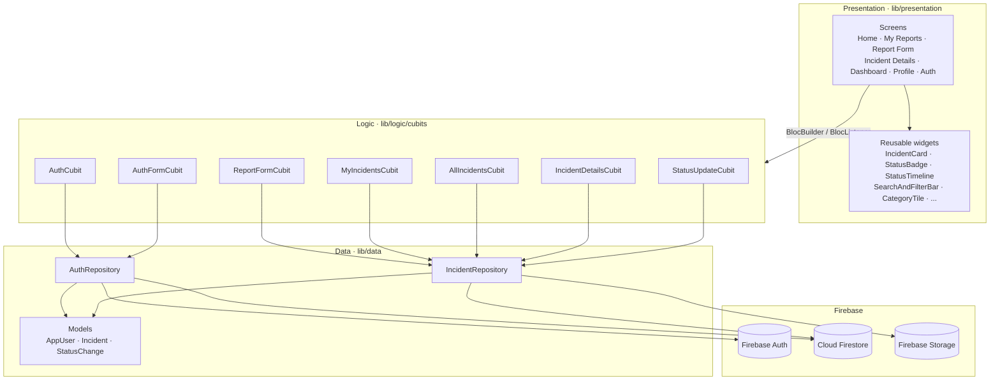

# Campus Incident Reporting App

A Flutter app for reporting and tracking campus issues. Students report problems
such as a broken light, a leaking tap or an unsafe area, with an optional photo,
and follow each report as it moves from **Submitted** to **In Progress** to
**Resolved**. Campus staff see every report and update its status.

Built for Android (Android emulator) and also runs in the browser
(`flutter run -d web-server`), with Firebase as the backend.

---

## Features

### Students
- **Accounts:** sign up (name, email, department, password), log in, reset a
  forgotten password. New accounts are always students.
- **Home:** a personal greeting, a "See an issue on campus?" banner, a report
  summary (total, In Progress, Resolved, Submitted) and the three most recent
  reports.
- **Report an Incident:** pick a category (Facilities, Water, Electricity,
  Safety, Sanitation), enter a title and description, choose a campus location
  and optionally attach a photo from the camera or gallery. Every field is
  validated, and the submit button is disabled while uploading.
- **My Reports:** a profile card with counts, search across title, description
  and location, status filter chips and a category filter.
- **Incident Details:** photo, status badge, location, date and reporter, a
  live **status timeline** with timestamps, and the description.
- **Profile:** avatar, name, email, department, role badge and log out.

### Staff
- **Dashboard:** counts across **all** incidents plus the full list, with the
  same search and filters.
- **Update Status:** on Incident Details, move a report one step forward after a
  confirmation dialog. Each change records the staff member in
  `statusHistory`.

### Security
- Firestore and Storage security rules enforce the roles on the server, not
  just in the UI. See [`firestore.rules`](firestore.rules) and
  [`storage.rules`](storage.rules).

---

## Tech stack

| Concern | Choice |
| --- | --- |
| Framework | Flutter (Dart 3) |
| State management | `flutter_bloc` (Cubit) + `equatable` |
| Auth | Firebase Auth (email/password) |
| Database | Cloud Firestore |
| File storage | Firebase Storage via the **Firebase Storage Emulator** (see below) |
| Navigation | `go_router` (`StatefulShellRoute` per role, redirects for auth/roles) |
| Photos | `image_picker` |
| Dates | `intl` |
| Testing | `flutter_test`, `bloc_test`, `mocktail` |

---

## Architecture

The app has four layers, and each layer only depends on the one below it:



- **Presentation** (`lib/presentation`) only renders state and forwards user
  actions to cubits. It never touches Firebase or the repositories.
- **Logic** (`lib/logic/cubits`) has one cubit and one immutable state per
  feature. Cubits depend on repositories, never on Firebase SDK types, which
  makes them easy to unit-test with mocks.
- **Data** (`lib/data`): the repositories are the **only** code that calls
  Firebase. They map documents to immutable models and turn Firebase errors
  into friendly messages (`AppException`).
- **Core** (`lib/core`): theme, constants (categories, statuses, locations),
  router and utilities (validators, date formatting). Every layer may use it.

### Navigation and roles

`AuthCubit` listens to Firebase Auth and then to the user's `users/{uid}`
document, so it always knows the signed-in user's **role**. `go_router` re-runs
its redirect whenever `AuthCubit` emits:

| Session | Allowed | Otherwise redirected to |
| --- | --- | --- |
| Loading | splash, auth screens | `/splash` |
| Signed out | `/login`, `/signup`, `/forgot-password` | `/login` |
| Student | `/home`, `/reports`, `/profile`, `/report`, `/incident/:id` | `/home` |
| Staff | `/staff`, `/staff/profile`, `/incident/:id` | `/staff` |

Students can never reach a `/staff` route. Even if they could, the Firestore
rules would reject any staff-only write.

### Project structure

```
lib/
├── main.dart                  # Firebase init + runApp
├── app.dart                   # Providers, theme, router
├── firebase_options.dart      # Generated by `flutterfire configure`
├── core/
│   ├── constants/             # AppConstants, IncidentCategory, IncidentStatus
│   ├── router/                # Routes, GoRouter, redirect rules
│   ├── theme/                 # AppColors, AppTextStyles, AppTheme
│   └── utils/                 # Validators, DateFormatter
├── data/
│   ├── models/                # AppUser, Incident, StatusChange
│   └── repositories/          # AuthRepository, IncidentRepository, AppException
├── logic/cubits/              # auth, auth_form, report_form, incident_list,
│                              # incident_details, status_update
└── presentation/
    ├── screens/               # auth, student, staff, report, incident, profile
    └── widgets/               # Reusable UI components
test/
├── unit/                      # Models, validators, enums, redirects, errors
├── cubits/                    # bloc_test + mocktail
└── widgets/                   # StatusBadge, IncidentCard, report form
```

---

## Firestore structure

```
users/{uid}
  name:        string
  email:       string
  role:        "student" | "staff"
  department:  string
  createdAt:   timestamp

incidents/{incidentId}
  title:         string          (max 60 chars)
  description:   string          (min 10 chars)
  category:      "facilities" | "water" | "electricity" | "safety" | "sanitation"
  location:      string          (one of AppConstants.campusLocations)
  imageUrl:      string | null   (Storage download URL)
  status:        "submitted" | "in_progress" | "resolved"
  reporterId:    string          (uid of the student)
  reporterName:  string
  createdAt:     timestamp
  updatedAt:     timestamp
  statusHistory: [
    { status, changedBy (uid), changedByName, timestamp }
  ]
```

**Storage:** `incident_photos/{incidentId}.jpg` (images only, under 5 MB), in the
Storage Emulator during development.

When a report is created, the app uploads the photo first (if there is one),
then writes the incident document with the photo's download URL and a first
`statusHistory` entry (`submitted`). A status update runs in a **transaction**
that checks the report is still at the expected step, then sets `status`,
`updatedAt` and appends a new entry to `statusHistory`.

The "My Reports" query (`where reporterId == uid`) is sorted on the device, so
it needs no composite index.

---

## Why the Storage Emulator

New Firebase projects need the paid **Blaze** plan to use Cloud Storage, so
this project keeps incident photos in the official **Firebase Storage
Emulator**, which runs on the developer's laptop. Everything else is real:

| Service | Where it runs |
| --- | --- |
| Firebase Auth | Cloud project `campus-incident-app-aedd3` |
| Cloud Firestore | Cloud project `campus-incident-app-aedd3` |
| Firebase Storage | Local Storage Emulator on port `9199` |

- The app uses the **same `firebase_storage` SDK** and the **same
  `storage.rules`**. The emulator enforces the rules exactly as the cloud would
  (signed-in users only, images under 5 MB).
- `main.dart` points only Storage at the emulator with `useStorageEmulator`,
  using `10.0.2.2` (the Android emulator's alias for the laptop) and port
  `9199`. The settings live in
  [`lib/core/constants/storage_config.dart`](lib/core/constants/storage_config.dart).
- The bucket is always named explicitly with `FirebaseStorage.instanceFor`, so
  the app doesn't depend on a default bucket that was never created.
- Emulator download URLs use plain `http://`, so **debug builds only** allow
  cleartext traffic (`android/app/src/debug/AndroidManifest.xml`).
- **Switching to the cloud bucket** only requires setting
  `StorageConfig.useEmulator = false`, once Storage is enabled on a Blaze
  project. Nothing else in the app changes.

Things to know:
- The emulator must be running whenever you **upload or view** photos.
- Photo URLs saved in Firestore point to `http://10.0.2.2:9199/...`, so they
  only load from the Android emulator on the same laptop while the Storage
  Emulator is running.
- The `emulator-data/` folder holds the exported photos. It is kept in the
  repo, not git-ignored, so sample photos survive restarts.

---

## Why Cubit?

- **Fits the problem:** most features are "call a repository, show
  loading/success/error" or "listen to a stream". A Cubit expresses that with
  plain methods (`submit()`, `advanceStatus()`, `searchChanged()`) and none of
  the event-class boilerplate that full Bloc needs.
- **Predictable, testable state:** each feature has one immutable `Equatable`
  state, so the UI is a pure function of it. With `bloc_test` and `mocktail`
  every cubit is tested in isolation, using mocked repositories and no
  Firebase.
- **Clear layering:** cubits sit between the UI and the repositories. Widgets
  never reach into Firebase, which keeps the screens simple and the business
  rules in one place.
- **Reuse:** `MyIncidentsCubit` and `AllIncidentsCubit` share one base class
  (`IncidentListCubit`) for live streaming, search and filters, and differ only
  in which stream they watch.
- **No `setState` for app state:** `setState` only covers tiny local UI details
  such as a password-visibility toggle.

---

## Setup

### Prerequisites
- Flutter SDK (stable, Dart ≥ 3.12) and Android Studio with an Android emulator
  (e.g. `Pixel_8`)
- Node.js, plus the Firebase CLI: `npm install -g firebase-tools`
- The FlutterFire CLI: `dart pub global activate flutterfire_cli`
- A Java JDK (the Firebase emulators run on Java; current `firebase-tools`
  needs JDK 21 or newer). Check with `java -version`.

### 1. Install dependencies
```bash
flutter pub get
```

### 2. Create and configure Firebase
1. In the [Firebase console](https://console.firebase.google.com/) create a
   project, or reuse an existing one.
2. **Authentication** → Sign-in method → enable **Email/Password**.
3. **Firestore Database** → create a database (production mode is fine,
   because the rules below will be deployed).
4. **Storage:** nothing to enable in the console. Photos go to the local
   Storage Emulator (see [Why the Storage Emulator](#why-the-storage-emulator)).
5. Connect the app. This generates `lib/firebase_options.dart` and
   `android/app/google-services.json`, and adds the Google Services Gradle
   plugin:
   ```bash
   firebase login
   flutterfire configure      # pick your project, select the Android platform
   ```

### 3. Deploy the security rules
```bash
firebase use --add            # choose campus-incident-app-aedd3 (one-time)
firebase deploy --only firestore:rules
```
The Storage rules (`storage.rules`) don't need deploying: the Storage
Emulator loads them from `firebase.json` when it starts. Once the project has
a cloud bucket on the Blaze plan, deploy both with
`firebase deploy --only firestore:rules,storage`.

### 4. Start the Storage Emulator
Run this in a separate terminal from the project root and leave it running
while you use the app:

```bash
firebase emulators:start --only storage --project campus-incident-app-aedd3 --import=./emulator-data --export-on-exit=./emulator-data
```

- `--import=./emulator-data` reloads the photos saved last time.
- `--export-on-exit=./emulator-data` saves them when you stop the emulator
  with **Ctrl+C**. Without a clean exit, new uploads are lost.
- On the very first run `emulator-data/` doesn't exist yet. The emulator
  starts empty and creates the folder on exit.
- Browse uploaded photos in the Emulator UI at <http://127.0.0.1:9191>
  (**Storage** tab).
- Ports come from `firebase.json` (`storage` on `9199`, UI on `9191`). If you
  change the Storage port, update `StorageConfig.emulatorPort` too.

### 5. Create a staff account
1. Run the app and **sign up** normally. Every new account is a student.
2. In the Firebase console go to **Firestore → users → {that user's uid}**.
3. Change the `role` field from `"student"` to `"staff"`.
4. The app switches to the staff dashboard right away, because the profile is
   watched live. Signing out and back in also works.

> Users can't change their own role from the app: the Firestore rules block
> any client write to `role`.

---

## Running on the emulator

Start the Storage Emulator first (setup step 4), then:

```bash
flutter emulators                      # list available emulators
flutter emulators --launch Pixel_8     # start one
flutter run                            # build and install the app
```

Camera tip: the emulator's virtual camera works with **Take a photo**. For
**Choose from gallery**, take a picture with the emulator's Camera app first,
or drag an image file onto the emulator window.

---

## Running in the browser (no Android emulator)

If the Android emulator is too heavy for your laptop, run the same app as a
web app:

```bash
# Terminal 1: Storage Emulator (same command as setup step 4)
firebase emulators:start --only storage --project campus-incident-app-aedd3 --import=./emulator-data --export-on-exit=./emulator-data

# Terminal 2: the app
flutter run -d web-server --web-port 8000
```

Then open <http://localhost:8000> in Chrome, Edge or Firefox.

- The web app is registered in Firebase as
  `1:379717583072:web:f3272e7ae40defaadd1085`, and its config is in
  `lib/firebase_options.dart`. After adding a platform, regenerate it with
  `flutterfire configure --project=campus-incident-app-aedd3 --platforms=android,web`.
- On the web the app talks to the Storage Emulator at `127.0.0.1:9199`. On
  Android it uses `10.0.2.2:9199`. `StorageConfig.displayUrl` rewrites saved
  photo URLs, so a photo uploaded from one platform also shows on the other.
- Photos are handled as bytes (`PickedImage`): uploaded with `putData` and
  previewed with `Image.memory`. That's why the same code works without a file
  system. On a desktop browser, **Take a photo** opens a file chooser.
- Use a fixed `--web-port` so the address stays the same between runs.
  `localhost` is already an authorised domain for Firebase Auth.

---

## Running the tests

```bash
flutter analyze
flutter test
```

| Suite | What it covers |
| --- | --- |
| `test/unit/models_test.dart` | `AppUser`, `Incident`, `StatusChange` `fromMap`/`toMap` round-trips and defaults |
| `test/unit/validators_test.dart` | Required, email, password, confirm, title, description, location, category |
| `test/unit/status_category_test.dart` | Status/category values, labels, colors, icons, `next` |
| `test/unit/router_redirect_test.dart` | Role-based redirects (students blocked from staff routes) |
| `test/unit/app_exception_test.dart` | Firebase error → friendly message mapping |
| `test/cubits/auth_cubit_test.dart` | Session/profile loading, roles, sign-out, login/sign-up form cubit |
| `test/cubits/report_form_cubit_test.dart` | Submit success, failure and validation |
| `test/cubits/my_incidents_cubit_test.dart` | Loading, search, status/category filters, errors |
| `test/cubits/status_update_cubit_test.dart` | Staff updates, students blocked, resolved reports |
| `test/widgets/*` | `StatusBadge`, `IncidentCard`, report form validation errors |

A manual end-to-end checklist is in [TESTING.md](TESTING.md).

---

## Screenshots

| Login | Home | Report an Incident |
| --- | --- | --- |
|  |  |  |

| My Reports | Incident Details | Staff Dashboard |
| --- | --- | --- |
|  |  |  |

> Placeholders: add your emulator screenshots to `docs/screenshots/` with the
> file names above.
